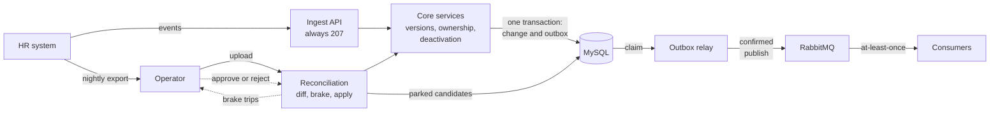
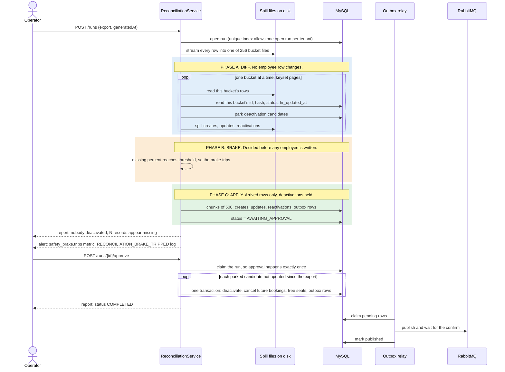

# HR Roster Sync: design note

## 1. Architecture

## 2. Nightly reconciliation

The gate between phases A and C is the safety argument. The brake counts what is missing before
any deactivation can run, and everything before it is a read or a parked row. A file that loses
30% or more of the active employees therefore deactivates nobody until a human decides.

## 3. Failure modes

| What fails | What the user sees | How the system recovers |
|---|---|---|
| Duplicate event | `DUPLICATE_NOOP` with `originalOutcome`, plus a warning if the payload differs | The unique key on tenant and `eventId` claims it once. No write, no event |
| Out-of-order event | `IGNORED_STALE` for the older one | Versions compare per owner, under a row lock. The newer state stands |
| Invalid record in a batch | 207, with that record `REJECTED`, naming the field and rule | The rest apply. The key stays unclaimed, so a corrected resend works |
| HR writes a transport-owned field | Applied, with a `FIELD_IGNORED_NOT_OWNED` warning | The field is dropped before the write. If nothing is left: `IGNORED_NO_OWNED_FIELDS`, no version change |
| Database unreachable mid-batch | 207: `PROCESSING_FAILED` on three records, `NOT_PROCESSED` on the rest | Fails fast after 3 consecutive failures. Earlier records stay committed, and a resend with the same ids is safe |
| Deadlock between concurrent new employees | Nothing in the load test: 0 of 24,000 records failed (10 before retries waited). Not a guarantee: a record that loses every retry gets `PROCESSING_FAILED` | Up to 5 retries, 10 to 80 ms apart at random. If they all lose, nothing was applied and the key is unclaimed, so a resend works |
| Crash between database write and publish | Nothing: the API had already answered | The outbox row committed with the change, and the relay publishes it after restart |
| Broker down | Nothing at the API. Downstream falls behind | Rows stay `PENDING`, with backoff from 1 s to a 5-minute cap, and drain on return. `roster.outbox.lag.seconds` rises |
| Broker down past the retry window | Nothing at the API. `roster.outbox.failed` rises | After 20 attempts (about 58 minutes) rows park as `FAILED`. Operator calls `POST /api/v1/outbox/failed/requeue` |
| Poisoned outbox row | Other rows are unaffected | Backoff moves it behind newer rows, and it parks as `FAILED` with `OUTBOX_ROW_PARKED` in the log |
| Truncated nightly export | Run stops at `AWAITING_APPROVAL`, nobody deactivated | Arrived rows still apply. Operator approves or rejects, and a new upload gets a 409 until then. A cut below the threshold looks like real exits and does deactivate. The next full export reactivates those people, but not their cancelled bookings |
| Malformed export row | Counted in the run report, never echoed | Fails alone. A readable id still counts as present. An unreadable one counts as missing, which the brake covers |
| Live update newer than the export | Counted in `skippedCount` | `hr_updated_at > generatedAt` means skip, checked under the row lock and again at approval |
| Two concurrent deactivations | Both succeed. The second is a no-op | Row lock on the employee. Each seat is freed once |
| Two concurrent reconciliation uploads | The second gets a 409 | A functional unique index allows one open run per tenant |
| Reconciliation process dies mid-run | Run stays `RUNNING`, and new uploads get a 409 for up to 5 minutes | The next upload after 5 silent minutes marks it `FAILED`. Finished chunks stand and the next export finds the rest. A hard kill leaves its temp spill directory behind, and nothing sweeps it |
| Cross-tenant read attempt | 404, identical to an id that does not exist | The tenant comes from the token only, so the other tenant's row is never found |
| Expired or tampered token | 401 with an empty body | Client logs in again. There is no refresh token, by design |
| Seat count drift | The departure still succeeds, and the booking is cancelled | The guarded decrement touches 0 rows, logs `SEAT_COUNT_DRIFT` at ERROR for a human, and a CHECK constraint stops the count going negative |
